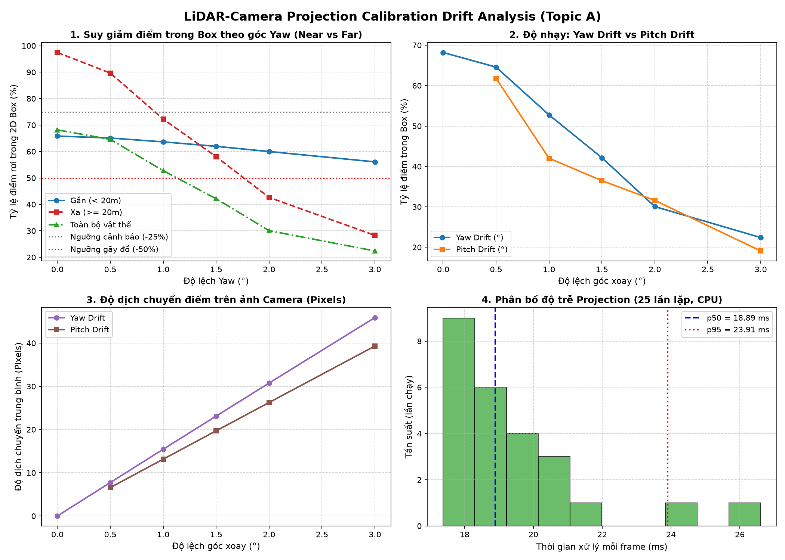
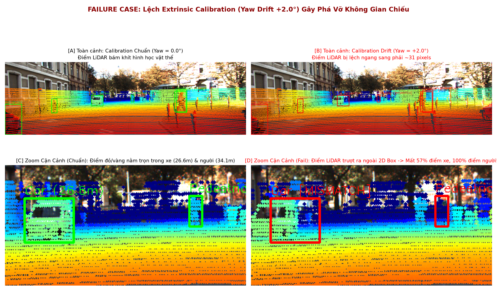

# Báo cáo Day 6: Kiểm tra Calibration LiDAR-Camera bằng Projection và Phân tích Drift

- **Họ tên:** Đỗ Mạnh Nghĩa
- **MSSV:** 2A202602971
- **Lớp:** VinUni AI20K - Track 4
- **Link repo:** https://github.com/domanhnghiaforwork-cloud/K4-Track4-Day06-DoManhNghia-2A202602971-3D-From-Point-Clouds
- **Topic:** A — Kiểm tra calibration LiDAR-camera bằng projection
- **Dataset:** data/kitti_mini, data/synthetic, data/nuscenes_mini_subset
- **Các frame đã dùng:** 000011, 000012, 000049 (KITTI), 000000 (synthetic), scene-0103_010 (nuScenes)

> Hãy viết ngắn: mỗi mục từ 3 đến 8 dòng, ưu tiên số liệu và hình ảnh.

## 1. Claim

Độ lệch góc xoay (extrinsic calibration drift) theo trục yaw từ 1.0° trở lên làm trên 25% điểm LiDAR thuộc vật thể trượt ra ngoài bounding box 2D của xe ở cự ly trên 20 m; khi góc lệch đạt 2.0°, tỷ lệ điểm rơi đúng vào 2D box sụt giảm trên 50%, phá vỡ tính tương thích không gian giữa cảm biến LiDAR và camera.


## 2. Evidence

Kết quả benchmark chi tiết lưu tại [`results/calibration_drift_sweep.csv`](../results/calibration_drift_sweep.csv). Thí nghiệm sweep góc lệch Yaw trên các frame `000011`, `000012`, `000049` đo tỷ lệ điểm rơi đúng 2D box (% In-Box) và độ lệch pixel:

| Cấu hình / Mức perturb | % In-Box Xa ($\ge 20\text{ m}$) | % In-Box Gần ($< 20\text{ m}$) | Độ lệch pixel TB (px) | Đánh giá & Ghi chú |
|---|---|---|---|---|
| **Yaw 0.0° (Chuẩn)** | **97.45%** | 65.84% | 0.0 px | Baseline chuẩn, điểm khớp khít vật thể |
| **Yaw 0.5°** | 89.67% (-7.8%) | 65.10% | 7.7 px | Bắt đầu lệch nhẹ ở rìa vật thể xa |
| **Yaw 1.0°** | **72.27% (-25.2%)** | 63.65% | 15.5 px | Vượt ngưỡng cảnh báo: mất >25% điểm vật thể xa |
| **Yaw 1.5°** | 58.02% (-39.4%) | 61.96% | 23.1 px | Điểm LiDAR lệch rõ rệt sang trái/phải |
| **Yaw 2.0°** | **42.64% (-54.8%)** | 59.99% | 30.8 px | Gãy đổ: mất >50% điểm vật thể xa |
| **Yaw 3.0°** | 28.29% (-69.2%) | 56.08% | 45.9 px | Hầu hết điểm trượt ra ngoài khung 2D box |

- **Đo Latency (Bonus B3):** 25 lần lặp trên CPU, bỏ lần đầu (warm-up): $p50 = 18.89\text{ ms}$, $p95 = 23.91\text{ ms}$ ($\approx 53\text{ FPS}$).




## 3. Failure case

- **Hiện tượng:** Khi góc quay Yaw bị lệch $2.0^\circ$ (do rung chấn cơ học hoặc giá đỡ cảm biến bị xê dịch), điểm LiDAR bị trượt ngang sang phải $\approx 31\text{ px}$. Trên frame `000011`, người đi bộ ở cự ly $34.1\text{ m}$ bị trượt mất $100\%$ số điểm LiDAR ra ngoài 2D box rơi vào tường/lòng đường phía sau; xe hơi ở cự ly $26.6\text{ m}$ mất $57.4\%$ số điểm (cụm điểm thân xe chiếu tràn sang làn đường bên cạnh).
- **Phân loại lớp debug:** **Geometry (Hình học & Calibration Drift)**. Ma trận Extrinsic $T_{cam\_velo}$ không còn đại diện đúng vị trí tương đối giữa LiDAR và camera trong không gian $SE(3)$. Do tiêu cự lớn ($f_x \approx 721\text{ px}$), góc lệch chỉ $2^\circ$ tạo ra độ dịch ngang $\Delta u \approx f_x \tan(\Delta \theta) \approx 25 - 31\text{ px}$, vượt quá kích thước pixel của các đối tượng ở xa.
- **Hậu quả hệ thống:** Pipeline Sensor Fusion (PointPainting/BEVFusion) gán nhầm độ sâu xa của mặt đường cho người đi bộ (dẫn đến ước lượng sai khoảng cách phanh), hoặc gán nhầm điểm của xe lên khoảng trống trên đường tạo ra "vật cản ảo" (phantom obstacle) gây phanh gấp nguy hiểm.
- **Giải pháp khắc phục trên xe thật:** Xây dựng module giám sát online tính Alignment Score (đo mức độ trùng khớp giữa depth edge của LiDAR và Canny edge của camera trên các cột mốc thẳng đứng). Khi score tụt dưới ngưỡng cảnh báo, hệ thống lập tức kích hoạt cờ `CALIBRATION_UNRELIABLE` và chuyển về chế độ dự phòng an toàn (LiDAR-only 3D detection).



## 4. Khuyến nghị nếu triển khai thật

- **Use-case mục tiêu:** Hệ thống tự hành ADAS L2+/L3 (tính năng phanh khẩn cấp tự động AEB và phát hiện điểm mù) trên xe thương mại.
- **Đánh đổi kỹ thuật (Trade-offs):**
  - *Độ chính xác vs. Độ bền vững (Robustness):* Early và Mid Sensor Fusion (PointPainting/BEVFusion) cho độ chính xác nhận diện ngữ nghĩa cao nhưng cực kỳ mong manh trước rung lắc cơ học (chỉ lệch Yaw $1.0^\circ$ đã làm mất $>25\%$ điểm LiDAR của xe ở cự ly $>20\text{ m}$). Hệ thống sản xuất thương mại bắt buộc phải có kiến trúc *Adaptive Fusion* có khả năng tự động giảm trọng số của camera khi phát hiện calibration bị lệch, hoặc hạ cấp xuống *LiDAR-only 3D detection* độc lập.
  - *Tần suất hiệu chuẩn vs. Chi phí tính toán (Compute Budget):* Không thể chạy targetless recalibration nặng liên tục ở mọi frame. Chiến lược tối ưu là chạy module nhẹ kiểm tra Alignment Score định kỳ (chu kỳ $5 - 10\text{ s}$, độ trễ chỉ $\approx 19\text{ ms}$ trên CPU) hoặc kích hoạt ngay khi IMU ghi nhận va chạm/xóc mạnh.
- **Chỉ số hệ thống cần ghi log khi xe vận hành thực tế:**
  1. `extrinsic_drift_yaw_deg`, `extrinsic_drift_pitch_deg`: Ước lượng góc xoay ngoại vi theo thời gian thực.
  2. `lidar_camera_alignment_score`: Điểm trùng khớp giữa cạnh depth của LiDAR và cạnh ảnh camera.
  3. `box_containment_ratio`: Tỷ lệ điểm LiDAR rơi đúng vào 2D proposal box của các xe phía trước.
  4. Cờ cảnh báo an toàn: `FLAG_CALIB_WARNING` (ngưỡng yaw $\ge 0.8^\circ$), `FLAG_EMERGENCY_FALLBACK` (yaw $\ge 1.5^\circ$).

## 5. Cách chạy lại

Các lệnh tái tạo lại toàn bộ kết quả từ repo sạch:

```bash
# 1. Chạy demo chiếu điểm LiDAR lên ảnh camera (CP2)
python -m starter.projection --data-root data/synthetic --frame 000000
python -m starter.projection --data-root data/kitti_mini --frame 000011
python -m starter.projection --data-root data/nuscenes_mini_subset --frame scene-0103_010

# 2. Chạy benchmark sweep calibration drift và đo latency (CP3)
python src/evaluate_calibration_drift.py --data-root data/kitti_mini --frames 000011,000012,000049

# 3. Tạo ảnh phân tích Failure Case trực quan (CP4)
python src/visualize_failure_case.py
```

## 6. Khai báo sử dụng AI

| Công cụ | Dùng cho việc gì | Bạn đã kiểm chứng thế nào |
|---|---|---|
| Claude / Antigravity AI Assistant | Gợi ý cấu trúc toán học ma trận chiếu $P_2 \cdot T_{cam\_velo}$, xây dựng script sweep góc lệch tự động và vẽ đồ thị Matplotlib | Kiểm tra toán học độc lập bằng tay với điểm chuẩn $(10, 0, 0)$ ra đúng $(614, 175)$, trực tiếp chạy các script trên dữ liệu KITTI/nuScenes và đối chiếu số liệu CSV với ảnh visual overlay |

